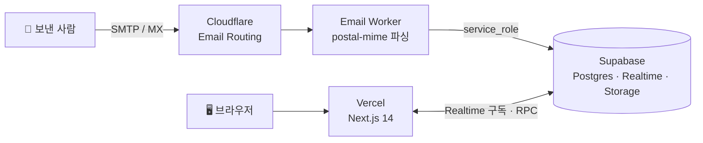

<div align="center">
  

  <h1>TempMail — 1회용 이메일 서비스</h1>

  <p>
    회원가입 없이 즉시 생성되는 <strong>1시간 임시 이메일</strong>.<br />
    Cloudflare Email Routing + Supabase + Next.js로 구현한 <strong>완전 서버리스</strong> 임시 메일 서비스입니다.
  </p>

  <p>
    <a href="https://mail.sia.kr"></a>
    
    
    
  </p>
</div>

---

## ✨ 주요 기능

- **즉시 주소 생성** — 원하는 아이디로 `...@sia.kr` / `...@mail.sia.kr` 주소를 바로 발급. 회원가입·로그인 불필요
- **실시간 수신함** — Supabase Realtime 구독으로 메일이 도착하는 순간 화면에 표시 (새 메일 브라우저 알림 포함)
- **OTP / 인증번호 자동 추출** — 본문에서 인증 코드를 자동 인식해 원클릭 복사
- **첨부파일 지원** — Supabase Storage 업로드 (개당 최대 5MB), 클릭 한 번으로 다운로드
- **본문 인라인 이미지** — `cid:` 삽입 이미지도 Storage 업로드 후 실제 URL로 치환해 표시
- **1시간 자동 삭제** — 메일별 60분 수명 (pg_cron), `보관(keep)` 토글로 필요한 메일은 예외 처리
- **잠금 수신함** — 비밀 키(`?k=`)가 있어야만 열람 가능한 비공개 모드, 생성 후 **24시간 뒤 자동 해제**
- **mailto 전달 & EML 다운로드** — 받은 메일을 내 메일앱으로 전달하거나 `.eml` 원본 저장
- **멀티 주소 바** — 여러 임시 주소를 동시에 띄워두고 전환하며 사용
- **PWA** — 홈 화면에 추가하면 앱처럼 실행 (standalone), OG/Twitter 카드 메타 포함

## 🏗️ 아키텍처



메일 수신은 Cloudflare가, 저장·실시간 푸시는 Supabase가, UI는 Vercel이 담당합니다.
서버(VPS) 없이 세 서비스의 무료 한도 안에서 운영됩니다.

## 📁 프로젝트 구조

```
tempmail/
├── tempmail-cloudflare/        # ✅ 현재 프로덕션 (서버리스)
│   ├── email-worker/           #   Cloudflare Email Worker — 메일 수신·파싱·Supabase 저장
│   ├── frontend/               #   Next.js 14 프론트엔드 — Vercel 배포
│   └── supabase/               #   DB 스키마 · RPC 함수 · pg_cron (schema.sql)
│
├── backend/                    # 레거시: Fastify API + Socket.io (VPS)
├── frontend/                   # 레거시: Next.js 프론트엔드 (VPS)
├── haraka/                     # 레거시: Haraka SMTP 서버 → Redis 저장
└── docker-compose.yml          # 레거시: 전체 스택 오케스트레이션
```

## 🚀 배포 가이드

프로덕션 버전(`tempmail-cloudflare/`) 배포 요약 — 상세 단계는
**[tempmail-cloudflare/README.md](tempmail-cloudflare/README.md)** 를 참조하세요.

1. **Supabase** — 프로젝트 생성 후 SQL Editor에서 `supabase/schema.sql` 실행
   (테이블 `emails` / `emails_locked` / `inbox_keys`, RPC 함수, `attachments` 버킷 포함)
2. **Cloudflare** — 도메인 네임서버 이전 → Email Routing 활성화 → Catch-all을 Email Worker로 지정
3. **Email Worker** — `wrangler secret put SUPABASE_SERVICE_ROLE_KEY` 후 `npm run deploy`
4. **Frontend** — `NEXT_PUBLIC_SUPABASE_URL` / `NEXT_PUBLIC_SUPABASE_ANON_KEY` 설정 후 Vercel 배포

## ⚙️ 레거시 VPS 버전

루트의 `backend/` · `frontend/` · `haraka/` · `docker-compose.yml`은 초기 VPS 기반 구현입니다
(Haraka SMTP → Redis → Fastify/Socket.io → Next.js).

25번 포트가 열린 서버와 MX 레코드가 필요하며, 현재는 서버리스 버전
(`tempmail-cloudflare/`)이 프로덕션으로 운영 중입니다. 레거시 스택은 참고용으로 유지됩니다.
